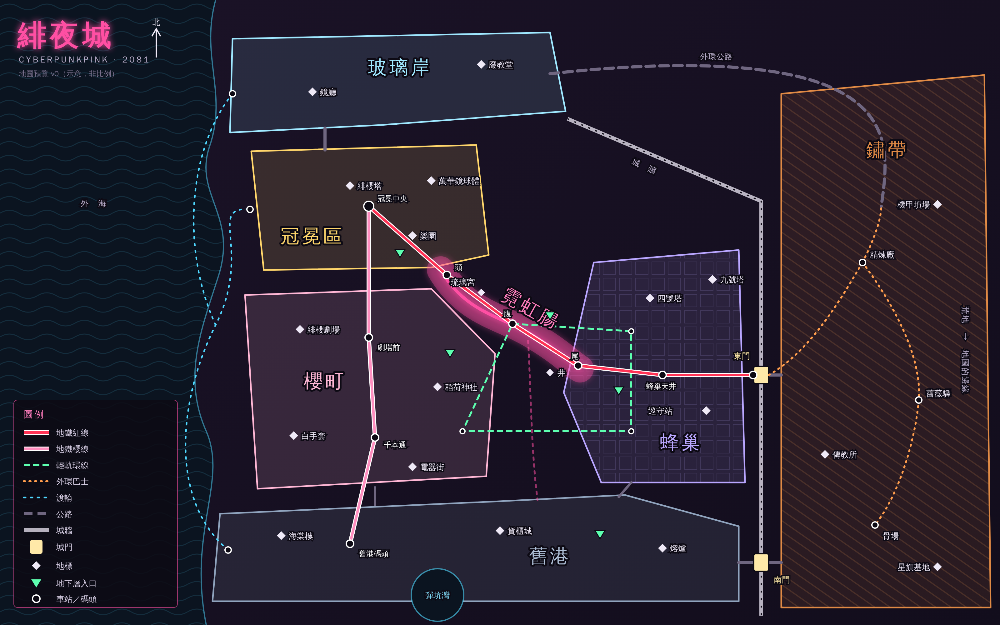

# 美術風格與繪圖管線

> 上層：[GAME_DESIGN](GAME_DESIGN.md)。依賴：[DISTRICTS](DISTRICTS.md)（地圖）、[CORE_RULES](CORE_RULES.md)（三條軌的顏色語意）。
> 檔案：`docs/art/`（SVG 原稿）、`docs/mockups/`（HTML 樣稿）、`docs/art/preview/`（轉出來的 PNG，給人看的）、`tools/art/render.mjs`（轉檔）。

設計階段能畫的東西先畫出來：地圖、介面樣式、圖標。**人物圖與背景圖不在這裡做**——那是之後生圖管線的事（ElondiaRPG 的 PORTRAITS、BACKGROUNDS）。

## 1. 怎麼畫

所有圖都是**手寫的向量與網頁**，不靠生圖模型：

| 種類 | 格式 | 為什麼 |
|---|---|---|
| 地圖、示意圖、圖標 | SVG | 文字檔，可以進版本控制、可以逐行修改、之後能直接放進遊戲 |
| 介面樣稿 | HTML + CSS | 樣稿裡的 CSS 變數就是實作時要用的設計代幣，不用重做一次 |
| 預覽 | PNG | 由 `tools/art/render.mjs` 用無頭瀏覽器轉出，方便在任何地方看 |

```bash
node tools/art/render.mjs
```

不給參數時把 `docs/art/` 與 `docs/mockups/` 裡的 SVG、HTML 全部轉到 `docs/art/preview/`；也可以指定檔案。需要 Node 22 與 Playwright。

**改圖的流程**：改 SVG 或 HTML → 轉檔 → 看 PNG → 再改。預覽圖進版本控制，這樣在 GitHub 上直接看得到。

## 2. 目前有的圖

| 圖 | 原稿 | 預覽 | 說明 |
|---|---|---|---|
| 緋夜城地圖 v0 | [`art/city-map.svg`](art/city-map.svg) | [`art/preview/city-map.png`](art/preview/city-map.png) | 八個區的位置、城牆與城門、地鐵兩線、輕軌、巴士、渡輪、主要地標、地下層入口。示意圖，非比例 |
| 地圖規模 v0 | [`art/map-scale.svg`](art/map-scale.svg)（由 `tools/art/gen_scale.py` 產生） | [`art/preview/map-scale.png`](art/preview/map-scale.png) | 一塊街區的格子樣本（蜂巢・天井市場，13×9）與八個區的 39 塊街區 |
| 樣式規劃 v0 | [`mockups/style-guide.html`](mockups/style-guide.html) | [`art/preview/style-guide.png`](art/preview/style-guide.png) | 色彩、三條軌的量條、按鈕與標籤、日誌、字、圖標風格（24 個樣本） |



## 3. 視覺方向

**一句話**：深紫黑的底，粉色的光，斜切的角。

- **深色底**。緋夜城沒有白天，介面也沒有淺色模式（至少第一版沒有）。
- **粉是訊號，不是底色**。整個畫面的粉不超過一成。它只出現在三種地方：玩家現在該看的東西、感載、被選中的東西。到處都粉就等於沒有粉。
- **斜切一角**。面板與按鈕切掉右上與左下，不用圓角。這是整個介面的招牌形狀，也是賽博龐克題材的共通語言。
- **格線**。底圖有很淡的方格，像設計圖。地圖、面板、日誌都坐在同一張格線上。
- **霓虹只給重要的東西**。發光（外暈）只用在標題、感載條、霓虹腸。
- **不可愛**。世界裡滿是可愛的東西（吉祥物、女僕、偶像），但介面本身是冷的、工具性的——玩家是隔著一層終端機在看這座城市。可愛留給內容。

## 4. 顏色的語意

色票與代號在樣稿的 `:root` 裡。語意固定，不混用：

| 顏色 | 意思 |
|---|---|
| 紅 | 生命值、肉體傷害、危險 |
| 粉 | 感載、神經、主要動作、粉蕾絲 |
| 青 | 人性、海、冷的東西 |
| 金 | 行動點、錢、冠冕區與企業 |
| 薄荷 | RAM、網內、成功、地下層 |
| 紫 | 蜂巢、一般的強調 |
| 鏽橘 | 鏽帶、巴士、舊的東西 |

每個區有代表色（地圖上的那一組）。進入該區時，介面的強調色換成那個顏色——玩家不看地名也知道自己在哪。

## 5. 圖標

- 24 格、線寬 1.6、圓頭圓角、不填色。
- **每個圖標只有一筆是粉的**：那一筆是它的重點（槍手的準星中心、感載的波形、契約的鎖扣）。
- 16px 要認得出來，所以形狀要簡單：一個主體、最多兩個細節。
- 之後的圖標照這個規格補：技能 18 個、義體部位 9 個、傷害類型 7 個、勢力徽記 26 個、設施。勢力徽記可以稍微破格（填色、用勢力自己的顏色）。

## 6. 之後要畫的

| 圖 | 用途 |
|---|---|
| 各區的街區圖 | 每區一張，比城市地圖細一級：街道、地標的實際位置、路口 |
| 地鐵路線圖 | 遊戲內的車站介面 |
| 主畫面樣稿 | 三欄佈局：地圖、日誌、設施與人 |
| 戰鬥畫面樣稿 | 站位（掩體／暴露／近身）怎麼呈現；兩條傷害軌 |
| 深潛畫面樣稿 | 子網的節點圖；網內與現實交錯的回合 |
| 義體部位圖 | 人形輪廓與九個部位的槽 |
| 勢力徽記 | 十二家企業、十四個幫派 |
