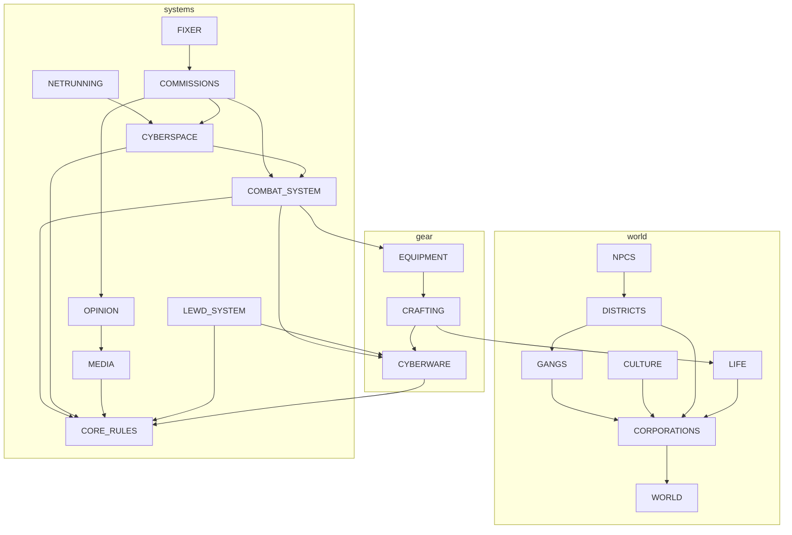

# 文件地圖

> 設計階段：還沒有程式，文件就是唯一真相。開始實作之後改成和 ElondiaRPG 一樣的規則——程式與資料是唯一真相，文件描述它們現在的行為。
> 想一口氣讀完：跑 `python3 tools/book/build.py`，在 `book/` 產生把下面所有文件依設計的分層（L0～L5，見第 1 節最後）編成的單一檔案。它是產物，不進版本控制。

## 1. 目錄

```
docs/
├─ README.md            這份：文件地圖
├─ GAME_DESIGN.md       總綱：這是什麼遊戲、設計原則、迴圈、系統地圖
├─ DOMAINS.md           索引：每個系統影響現實戰鬥、內海戰鬥、輿論戰的哪一個
│
├─ world/               世界：這座城市是什麼樣子
│   ├─ WORLD            世界線、年表、用語對照
│   ├─ CORPORATIONS     企業：兩個級別與文化分支
│   ├─ GANGS            街頭勢力：主要、次要與文化分支
│   ├─ CULTURE          御宅文化、獸化、女僕、偶像、同人、街頭用語
│   ├─ DISTRICTS        八個區、地圖規模、要地、橋接區、交通
│   ├─ NPCS             固定 NPC、十二位夥伴、四十二個流竄 AI、穿過很多人的線、傳奇人物
│   ├─ LIFE             錢、身分與掃橋、法律、等級、牌子、藥、通訊、一週的節奏與城市的大事、行規
│   ├─ FACTIONS         二十九個勢力的關係表、好感與敵對值的來源
│   ├─ STORY_QUESTS     特殊任務的格式、旗標與計數器；路數、中間人、夥伴、流竄 AI、勢力的線的骨架
│   └─ SITES            39 塊街區、17 處要地、任務區域、副本的現實面模板、內海的固定地點、設施
│
├─ systems/             規則：遊戲怎麼玩
│   ├─ CORE_RULES       屬性、基本功、檢定、三條軌、同步、路數、技能與容量、成長、名聲
│   ├─ CHARACTER        建角、出身、生命軌跡、特質與缺陷
│   ├─ COMBAT_SYSTEM    現實戰鬥、戰敗、召喚與機甲
│   ├─ CYBERSPACE       內海：分區、化身、構裝、網內戰鬥、精神污染
│   ├─ NETRUNNING       竄網：快駭、蕾絲、追蹤度、粉牆
│   ├─ OPINION          輿論戰：3×3 棋盤的議題戰役與頻道的經營層
│   ├─ MEDIA            媒體：拍片與直播兩條流程、偶像
│   ├─ COMMISSIONS      委託副本：三到五個階段、每階段選一面、主面與輔助面、連動、類型
│   ├─ FIXER            中間人、一案四拍、每週帳單、掮客、名冊、派工、人情、據點的等級
│   ├─ LEWD_SYSTEM      成人向：橋參數、傾向、成人場景、調校、豔名、場所、契約、內容篩選、夜課
│   ├─ DATA             資料的格式：每一種內容一筆完整的樣本
│   ├─ BALANCE          數值平衡：方法、I～V 級的核心曲線、難度、模擬器與偏差報告
│   ├─ SKILLS           九棵技能樹：八條路數加夜課的框架
│   ├─ ENEMIES          敵人：等級與位階、各勢力、蕾絲、機甲、敵人 AI
│   ├─ NPC_SYSTEM       NPC 的生成、互動、關係與記憶、夥伴
│   ├─ EVENTS           統一的事件導演與各範圍的事件
│   ├─ SERIES           系列：事件、線索、特殊任務、委託副本的分組；線索池
│   ├─ DOWNTIME         休息、治療、分階段的打工、帳單、區域狀態、格子地圖的家園
│   ├─ TRADE            商店、價格、殺價、黑市、價差
│   └─ PROMPTS          提示詞、世界書、文風
│
├─ content/             內容（L4）：照規則寫出來的一筆一筆的東西
│   ├─ QUESTS           特殊任務的完整寫法（照 STORY_QUESTS 的骨架）
│   ├─ COMMISSION_TEMPLATES  委託模板
│   ├─ SKILL_TREES      技能樹的技能清單
│   ├─ ENEMY_ROSTER     敵人名單
│   ├─ EVENTS_CITY、ADULT_EVENTS、DEFEAT_EVENTS、LURE_EVENTS  城市事件、成人事件、戰敗事件、流竄 AI 的接觸
│   ├─ NIGHT_LESSONS    夜課
│   └─ GUIDES           指南
│
├─ gear/                裝備：身上有什麼
│   ├─ CYBERWARE        義體：部位、沉溺成本、授權鎖、惡意韌體、溺感症、橋的型號
│   ├─ CRAFTING         組裝：設計圖與零件、等級、機械與生體、組裝與拆解
│   ├─ EQUIPMENT        身上的裝備：欄位、外套、藏匿、快取格
│   └─ ITEMS            目錄：設計圖、零件、藥、工具、飾品
│
├─ art/                 美術
│   ├─ ART_STYLE        視覺方向、顏色語意、圖標規格、繪圖管線
│   ├─ UI               各畫面的版面
│   ├─ *.svg            地圖、示意圖與勢力圖的原稿
│   └─ preview/         轉出來的 PNG
├─ mockups/             樣式規劃與三個可以操作的 Demo（HTML）；介面的參考實作已經換成 ../ui/
│
├─ plan/                計畫：還沒做完的事
│   ├─ PLAN             現在的計畫與還沒解決的事
│   ├─ IMPLEMENTATION   實作的起點：Agent 模式、程式掃描、減熵清單
│   ├─ MIGRATION        ElondiaRPG 系統遷移清單
│   ├─ CODESCAN         ElondiaRPG 程式掃描的結論
│   ├─ AI_TASKS         AI 任務與工具（Agent 模式）
│   └─ IDEAS            點子庫：還沒決定要不要做的想法
│
├─ log/                 紀錄
│   └─ DECISIONS        已經定案的決定：決定了什麼、原本是什麼
│
└─ book/                設計書：全部文件編成的單一檔案（由 tools/book/ 產生；只在本機，不進版本控制）
```

**設計的分層**：下層的規則是上層的前提，文件裡說的「L3 框架」「L4 的內容」指的是這一張表。設計書也照它編排。

| 層 | 是什麼 | 包含 |
|---|---|---|
| L0 世界 | 這座城市是什麼、用什麼詞 | 世界線與年表、用語、八區、勢力與文化分支、固定 NPC、流竄 AI |
| L1 核心規則 | 一個角色由哪些數字組成、怎麼擲骰 | 六屬性、十八項基本功、檢定、三條軌、同步原則、名聲、成長 |
| L2 核心玩法 | 三個戰場怎麼打 | 現實戰鬥、內海戰鬥、輿論戰、召喚 |
| L3 框架 | 內容的格式與規則，不含內容本身 | 技能、裝備、敵人、NPC、事件、系列、委託副本、經濟、家園、成人場景與契約、資料格式、平衡 |
| L4 內容 | 實際的條目 | 技能清單、物品目錄、敵人名單、事件、特殊任務、委託模板、街區與要地 |
| L5 呈現 | 給玩家看與給 AI 讀的 | 畫面、提示詞與世界書、AI 任務與工具 |

## 2. 從哪裡開始讀

| 你想知道 | 讀 |
|---|---|
| 這是什麼遊戲 | [GAME_DESIGN](GAME_DESIGN.md) |
| 世界觀 | [world/WORLD](world/WORLD.md) → [CORPORATIONS](world/CORPORATIONS.md) → [GANGS](world/GANGS.md) → [CULTURE](world/CULTURE.md) → [DISTRICTS](world/DISTRICTS.md) |
| 角色怎麼建、怎麼成長 | [systems/CORE_RULES](systems/CORE_RULES.md) → [gear/CYBERWARE](gear/CYBERWARE.md) 第 7 節 |
| 三個戰場各怎麼打 | [COMBAT_SYSTEM](systems/COMBAT_SYSTEM.md)、[CYBERSPACE](systems/CYBERSPACE.md)、[OPINION](systems/OPINION.md)；總表在 [DOMAINS](DOMAINS.md)。三個戰場各有一個可以操作的 Demo，放在 `mockups/` |
| 一件委託怎麼進行 | [systems/FIXER](systems/FIXER.md) 第 2 節 → [systems/COMMISSIONS](systems/COMMISSIONS.md) |
| 裝備怎麼來 | [gear/CRAFTING](gear/CRAFTING.md) → [gear/EQUIPMENT](gear/EQUIPMENT.md) |
| 成人向的部分 | [systems/LEWD_SYSTEM](systems/LEWD_SYSTEM.md) |
| 一條特殊任務的完整寫法 | [world/STORY_QUESTS](world/STORY_QUESTS.md) → [content/QUESTS](content/QUESTS.md) |
| 還有什麼沒決定、接下來做什麼 | [plan/PLAN](plan/PLAN.md) |
| 一件事是什麼時候、為什麼這樣定的 | [log/DECISIONS](log/DECISIONS.md) |

## 3. 依賴關係

箭頭 A → B 表示「A 的規則用到 B」。



**樞紐**：[CORE_RULES](systems/CORE_RULES.md) 的三條軌（生命值、感載、沉溺）、同步原則、三個戰場的矩陣被所有規則用到；改它們要一起看 COMBAT_SYSTEM、CYBERSPACE、CYBERWARE、LEWD_SYSTEM、DOMAINS。

## 4. 維護規則

1. **一件事只寫在一個地方**，其他文件只放連結。企業的介紹只寫在 CORPORATIONS；感載的公式只寫在 CORE_RULES 第 4 節；三個戰場的等級只寫在 CORE_RULES 6.1 節；設計圖與零件只寫在 CRAFTING。
2. **用語以 [WORLD](world/WORLD.md) 第 7 節為準**。新造的詞先加進對照表再用。
3. **文件只寫定案的規則與真的還沒解決的事。** 還沒決定的事寫進 [plan/PLAN](plan/PLAN.md)，不要散在各文件；各文件最後的「待確認」只放那一份自己的細項。決定之後把結論用現在式寫回文件，原本是什麼、為什麼改，記進 [log/DECISIONS](log/DECISIONS.md)，不留在文件裡。
4. **數值都還要平衡**。公式只是為了說明量級，實作時放進 `data/rules/*.json`。
5. **新增文件時**：放進對應的目錄，開頭寫「上層／依賴／被依賴」，加進本文件的目錄與 `tools/book/build.py` 的順序。
6. **改了章節編號要跑檢查**：`python3 tools/docs/check.py` 會找出斷掉的連結與指向不存在章節的引用。
7. **設計書**：文件有大改動後重編——`python3 tools/book/build.py`，再 `node tools/book/pdf.mjs`。
8. **圖**：改了 `art/` 的 SVG 或 `mockups/` 的 HTML 之後跑 `node tools/art/render.mjs`。
