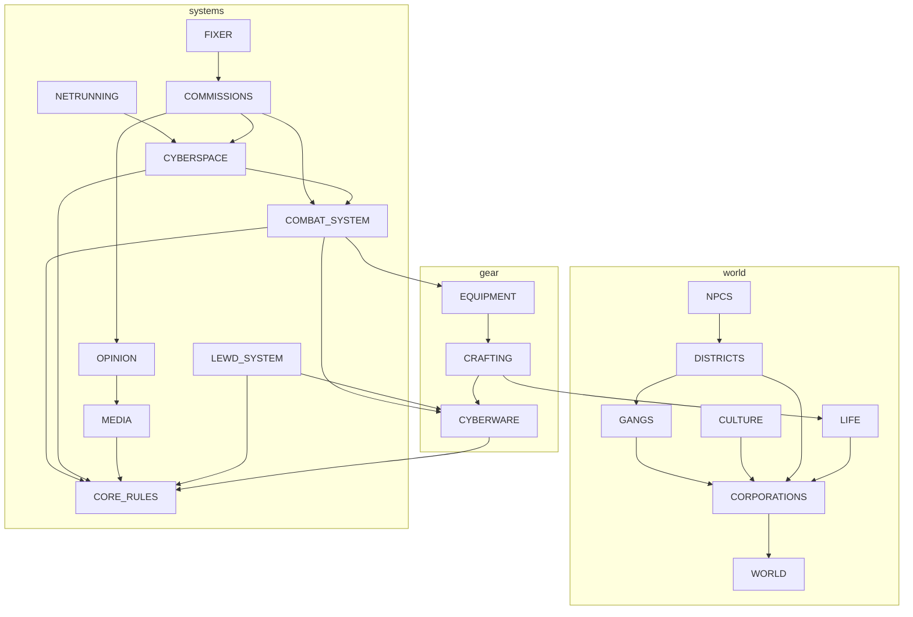

# 文件地圖

> 設計階段：還沒有程式，文件就是唯一真相。開始實作之後改成和 ElondiaRPG 一樣的規則——程式與資料是唯一真相，文件描述它們現在的行為。
> 想一口氣讀完：跑 `python3 tools/book/build.py`，在 `book/` 產生把下面所有文件照閱讀順序編成的單一檔案。它是產物，不進版本控制。

## 1. 目錄

```
docs/
├─ README.md            這份：文件地圖
├─ GAME_DESIGN.md       總綱：這是什麼遊戲、設計原則、迴圈、系統地圖
├─ DOMAINS.md           索引：每個系統影響現實戰鬥、內海戰鬥、輿論戰的哪一個
│
├─ world/               世界：這座城市是什麼樣子
│   ├─ WORLD            世界線、年表、用語對照
│   ├─ CORPORATIONS     企業：兩個級別與文化分支
│   ├─ GANGS            街頭勢力：主要、次要與文化分支
│   ├─ CULTURE          御宅文化、獸化、女僕、偶像、同人、街頭用語
│   ├─ DISTRICTS        八個區、地圖規模、要地、橋接區、交通
│   ├─ NPCS             固定 NPC、九位夥伴、六條主線骨架
│   └─ LIFE             錢、身分、法律、等級、牌子、藥、通訊、曆、行規
│
├─ systems/             規則：遊戲怎麼玩
│   ├─ CORE_RULES       屬性、基本功、檢定、三條軌、同步、路數、技能與容量、成長、名聲
│   ├─ COMBAT_SYSTEM    現實戰鬥、戰敗、女武神機甲
│   ├─ CYBERSPACE       內海：分區、化身、構裝、網內戰鬥、精神污染
│   ├─ NETRUNNING       竄網：快駭、蕾絲、追蹤度、粉牆
│   ├─ OPINION          輿論戰：頻道經營與議題戰役
│   ├─ MEDIA            媒體的基礎與偶像
│   ├─ COMMISSIONS      委託副本：主面與輔助面、領域指標、類型
│   ├─ FIXER            中間人、一案四拍、每週帳單、名冊、人情、據點
│   └─ LEWD_SYSTEM      成人向：橋參數、調校、豔名、場所、契約、內容篩選
│
├─ gear/                裝備：身上有什麼
│   ├─ CYBERWARE        義體：部位、沉溺成本、授權鎖、惡意韌體、溺感症、橋的型號
│   ├─ CRAFTING         工藝：設計圖與零件、等級、機械與生體、組裝與拆解
│   └─ EQUIPMENT        身上的裝備：欄位、外套、藏匿、快取格
│
├─ art/                 美術
│   ├─ ART_STYLE        視覺方向、顏色語意、圖標規格、繪圖管線
│   ├─ *.svg            地圖與示意圖的原稿
│   └─ preview/         轉出來的 PNG
├─ mockups/             介面樣稿（HTML）
│
├─ plan/                計畫：還沒做完的事
│   ├─ ROADMAP          待決定的問題、還沒寫的文件、實作階段
│   ├─ SYSTEMS_REVIEW   系統盤點：哪些設計決定過過了、哪些還沒
│   ├─ WORLD_ITEMS      世界觀項目的盤點
│   ├─ MIGRATION        ElondiaRPG 系統遷移清單
│   ├─ IMPLEMENTATION   實作的起點：Agent 模式、程式掃描、減熵清單
│   ├─ CODESCAN         ElondiaRPG 程式掃描的結論
│   ├─ AI_TASKS         AI 任務與工具（Agent 模式）
│   └─ scan/            掃描的六份原始報告（不進設計書）
│
└─ book/                設計書：全部文件編成的單一檔案（由 tools/book/ 產生；只在本機，不進版本控制）
```

## 2. 從哪裡開始讀

| 你想知道 | 讀 |
|---|---|
| 這是什麼遊戲 | [GAME_DESIGN](GAME_DESIGN.md) |
| 世界觀 | [world/WORLD](world/WORLD.md) → [CORPORATIONS](world/CORPORATIONS.md) → [GANGS](world/GANGS.md) → [CULTURE](world/CULTURE.md) → [DISTRICTS](world/DISTRICTS.md) |
| 角色怎麼建、怎麼成長 | [systems/CORE_RULES](systems/CORE_RULES.md) → [gear/CYBERWARE](gear/CYBERWARE.md) 第 7 節 |
| 三個戰場各怎麼打 | [COMBAT_SYSTEM](systems/COMBAT_SYSTEM.md)、[CYBERSPACE](systems/CYBERSPACE.md)、[OPINION](systems/OPINION.md)；總表在 [DOMAINS](DOMAINS.md) |
| 一件委託怎麼進行 | [systems/FIXER](systems/FIXER.md) 第 2 節 → [systems/COMMISSIONS](systems/COMMISSIONS.md) |
| 裝備怎麼來 | [gear/CRAFTING](gear/CRAFTING.md) → [gear/EQUIPMENT](gear/EQUIPMENT.md) |
| 成人向的部分 | [systems/LEWD_SYSTEM](systems/LEWD_SYSTEM.md) |
| 還有什麼沒決定 | [plan/ROADMAP](plan/ROADMAP.md)、[plan/SYSTEMS_REVIEW](plan/SYSTEMS_REVIEW.md) |

## 3. 依賴關係

箭頭 A → B 表示「A 的規則用到 B」。



**樞紐**：[CORE_RULES](systems/CORE_RULES.md) 的三條軌（生命值、感載、沉溺）、同步原則、三個戰場的矩陣被所有規則用到；改它們要一起看 COMBAT_SYSTEM、CYBERSPACE、CYBERWARE、LEWD_SYSTEM、DOMAINS。

## 4. 維護規則

1. **一件事只寫在一個地方**，其他文件只放連結。企業的介紹只寫在 CORPORATIONS；感載的公式只寫在 CORE_RULES 第 4 節；三個戰場的等級只寫在 CORE_RULES 6.1 節；設計圖與零件只寫在 CRAFTING。
2. **用語以 [WORLD](world/WORLD.md) 第 7 節為準**。新造的詞先加進對照表再用。
3. **還沒決定的事寫進 [plan/](plan/ROADMAP.md)**，不要散在各文件；決定之後把結論寫回系統文件。新寫的系統先在 [SYSTEMS_REVIEW](plan/SYSTEMS_REVIEW.md) 標成「寫了沒過」。
4. **數值都是初稿**。公式只是為了說明量級，實作時放進 `data/rules/*.json`。
5. **新增文件時**：放進對應的目錄，開頭寫「上層／依賴／被依賴」，加進本文件的目錄與 `tools/book/build.py` 的順序。
6. **改了章節編號要跑檢查**：`python3 tools/docs/check.py` 會找出斷掉的連結與指向不存在章節的引用。
7. **設計書**：文件有大改動後重編——`python3 tools/book/build.py`，再 `node tools/book/pdf.mjs`。
8. **圖**：改了 `art/` 的 SVG 或 `mockups/` 的 HTML 之後跑 `node tools/art/render.mjs`。
