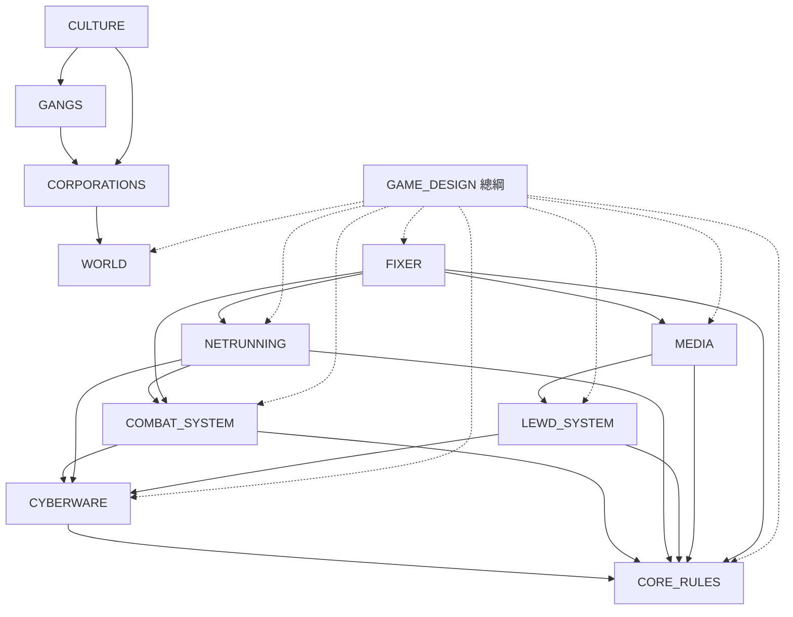

# 文件地圖

> 目前是**設計階段**：還沒有程式，文件就是唯一真相。開始實作之後改成和 ElondiaRPG 一樣的規則——程式（`src/`）與資料（`data/`）是唯一真相，文件描述它們現在的行為。

## 1. 階層

```
GAME_DESIGN（總綱：原則、遊戲迴圈、報告、AI 管線、和 ElondiaRPG 的對照）
│
├─ 世界
│   └─ WORLD              世界線、歷史、緋灣市、用語對照
│       ├─ CORPORATIONS   十二家企業：來歷、部門、怎麼拴住人、帶來哪些案子
│       ├─ GANGS          十四個幫派與兩個街頭組織
│       └─ CULTURE        御宅文化：獸化改造、女僕、偶像、萌的工程學、同人、街頭用語
│
├─ 基礎規則（被所有系統依賴）
│   ├─ CORE_RULES         屬性、技能、檢定、三條軌（生命／感載／人性）、路數、成長、名聲與熱度
│   └─ CYBERWARE          義體：部位、人性成本、雙面效應、授權鎖、惡意韌體、溺感症
│
├─ 三條主玩法
│   ├─ COMBAT_SYSTEM      戰鬥：行動點、站位與掩體、護甲、重創、戰敗、女武神機甲
│   ├─ NETRUNNING         竄網：快駭、深潛、蕾絲（LACE）、追蹤、粉牆
│   ├─ MEDIA              媒體：素材、剪輯、發布、直播、公信力與流量
│   └─ FIXER              中間人與案子：一案一團的流程、盤口、名冊、人情、據點
│
├─ 成人向
│   └─ LEWD_SYSTEM        橋參數（慾望指標）、調校、豔名、場所、契約與橋權、內容篩選
│
└─ plan/
    └─ ROADMAP            實作階段、待決定的問題
```

之後會補的文件（先在總綱與 ROADMAP 佔位）：`NPC_SYSTEM`、`DISTRICTS`（各區地圖與地標）、`ITEMS`、`TRADE`、`EVENTS`、`PROMPTS`、`SAVES`、`CONTENT_EDITOR`。這幾份和 ElondiaRPG 的同名文件差異最小，等核心規則定案後再寫。

## 2. 依賴關係

箭頭 A → B 表示「A 的規則用到 B」。



**樞紐**：`CORE_RULES` 的三條軌（生命、感載、人性）與「同步」原則被所有玩法用到；改它們的公式時要一起看 COMBAT_SYSTEM、NETRUNNING、CYBERWARE、LEWD_SYSTEM。

## 3. 維護規則

1. **一件事只寫在一個地方**，其他文件只放連結。例：企業的介紹只寫在 CORPORATIONS，WORLD 只列名單；感載的公式只寫在 CORE_RULES 第 4 節；蕾絲的種類只寫在 NETRUNNING 第 4 節；用語對照只寫在 WORLD 第 7 節。
2. **用語以 WORLD 第 7 節為準**。新造的詞先加進對照表再用。
3. **還沒決定的事寫進 [plan/ROADMAP](plan/ROADMAP.md) 的「待決定」**，不要散在各文件；決定之後把結論寫回系統文件，再從清單刪掉。
4. **數值都是初稿**。標了「（初稿）」的公式只是為了說明量級，實作時放進 `data/rules/*.json`，改 JSON 就能調整。
5. **新增文件時**：開頭寫「上層／依賴／被依賴」，並加進本文件的階層與依賴圖。
